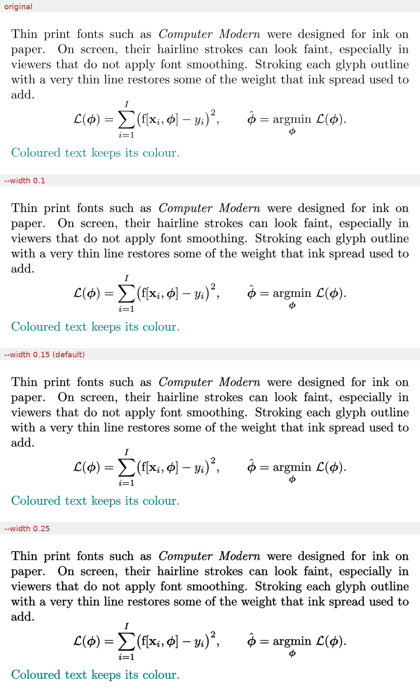

# pdf-embolden

Make thin print fonts in a PDF look heavier on screen, without moving a single glyph.



## Why

Computer Modern and Latin Modern, the LaTeX defaults, were designed for ink on paper. Their hairline strokes and serifs rely on ink spread to look solid. On screen, especially in viewers that draw text without font smoothing such as PDF.js (used by Zotero and Firefox), these fonts can look faint and spindly compared with how macOS Preview renders the same file.

## How it works

For text set in matching fonts, the script switches the PDF text render mode from *fill* to *fill + stroke* and strokes each glyph outline with a thin line in the same colour as the fill. It uses round line joins so serifs don't grow miter spikes, and it restores the original graphics state after each text object so rules, figures and other drawings are unaffected.

Nothing else changes. Glyph positions, page geometry and the text layer stay exactly the same, so search, selection and copy work as before, and annotations stored by reference managers such as Zotero stay aligned with the text.

## Install

```bash
pip install -r requirements.txt   # just pikepdf
```

## Usage

```bash
# Default: 0.15 pt stroke on Computer Modern / Latin Modern / AMS symbol fonts
python embolden.py book.pdf book_bold.pdf

# Choose the stroke width in points (0.1 subtle, 0.2 clearly heavier, 0.3 near semibold)
python embolden.py book.pdf book_bold.pdf --width 0.2

# See which fonts the PDF uses and which ones the pattern matches
python embolden.py book.pdf --list-fonts

# Target other fonts with a regex, e.g. Times clones
python embolden.py paper.pdf paper_bold.pdf --fonts "Times|NimbusRom|TeXGyreTermes|STIX"

# Leave figures (form XObjects) untouched
python embolden.py book.pdf book_bold.pdf --no-forms
```

Font names are matched with the six-letter subset tag removed (`ABCDEF+CMR10` is matched as `CMR10`).

## Using it with Zotero

To keep existing annotations, replace the attachment file in place rather than importing a new one:

1. Close the PDF's tab in Zotero.
2. Right-click the attachment and choose **Show File**.
3. Back up the original, then overwrite it with the processed file, keeping the original filename.
4. Reopen it in Zotero.

## Notes and limitations

- The stroke width is in PDF user-space units (points on a normal page), so the effect scales with the text and looks the same at every zoom level. A 0.15 pt stroke adds about 0.075 pt to each side of every stroke.
- The change is real, not a display setting: the processed file also looks bolder in every other viewer and when printed.
- Type 3 fonts (e.g. bitmap fonts from old dvips workflows) ignore text render modes and are left as they are.
- Text that already uses a non-default render mode (outlines, clipping, invisible OCR text) is left as it is.
- Tested with PDF.js (Zotero, Firefox) and Poppler.

## Development

```bash
pip install -r requirements-dev.txt
pytest
```

Tests marked `xfail` describe known limitations; they are strict, so fixing one makes the suite flag the test to be un-marked.

## 中文說明

Computer Modern／Latin Modern 這類 LaTeX 預設字型筆畫極細，在 Zotero、Firefox 等以 PDF.js 渲染、沒有字型平滑的閱讀器裡看起來特別淡。這個腳本會把符合條件字型的文字改成「填色＋描邊」模式，用同色細線描出字形外框來加粗。字的位置與文字層完全不變，搜尋、選取不受影響，Zotero 裡既有的註記也不會跑位。

```bash
pip install -r requirements.txt
python embolden.py 原檔.pdf 加粗.pdf --width 0.15
python embolden.py 原檔.pdf --list-fonts   # 查看 PDF 用了哪些字型
```
